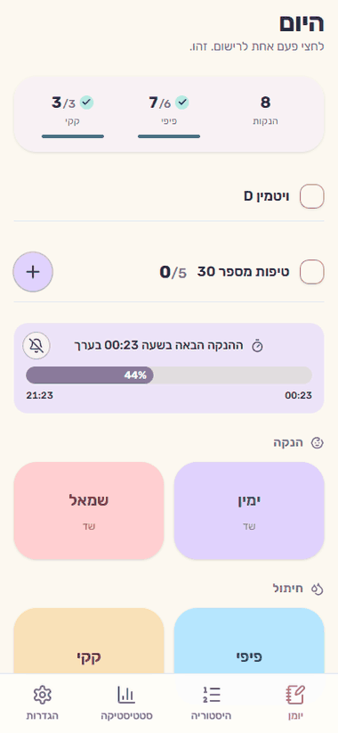
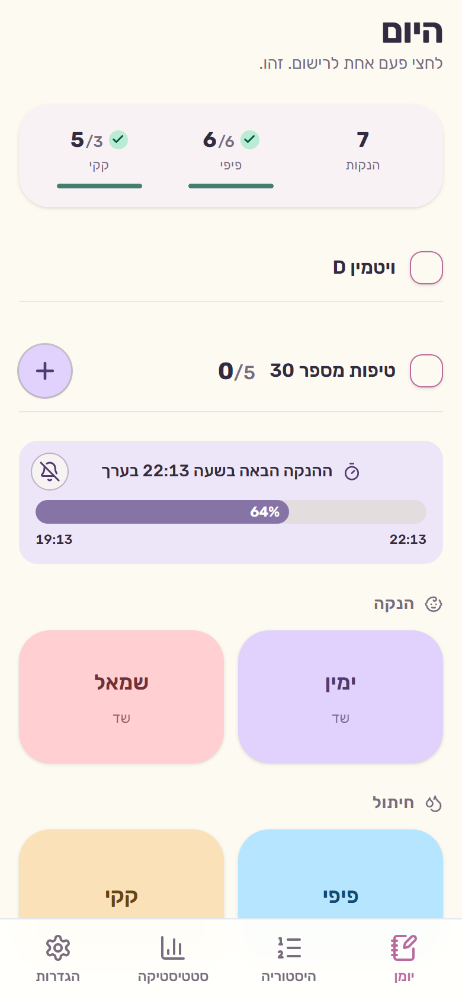
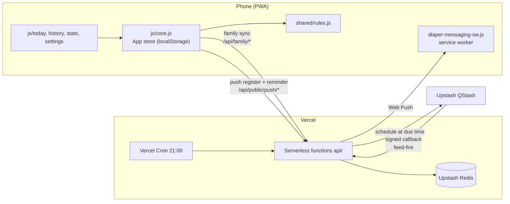

<div dir="rtl">

## יומן תינוק – הנקות, חיתולים וויטמין D

בניתי את האפליקציה עבור אשתי אחרי הלידה של בננו. היא רצתה לדעת כמה פעמים הניקה, כמה זמן נמשכה כל הנקה, ולעקוב אחרי הפעילות היומית של התינוק (חיתולים, ויטמין D) במקום אחד ובלחיצה אחת. האפליקציה הופכת את המעקב היומיומי לנתונים ברורים ועוזרת לזהות דפוסים לאורך זמן.

אפליקציית PWA בעברית לרישום הנקות (ימין/שמאל, עם טיימר), חיתולים (פיפי/קקי) מול יעד יומי, ויטמין D וטיפות. כוללת היסטוריה עם ציר זמן יומי, סטטיסטיקה שמתחשבת בשבת, תזכורת להנקה הבאה בהתראת Push גם כשהאפליקציה סגורה, ושיתוף בין בני המשפחה בלי חשבונות. הנתונים נשמרים במכשיר. הפרויקט התחיל כהעתק של mama-helper (Lovable) והורחב משם.

</div>

---

# Baby Feeding Log

[](https://github.com/roeiraz12/baby-feeding-log/actions/workflows/ci.yml)
[](LICENSE)

A one-tap baby journal for new parents: nursing sessions (left/right with a running timer), wet and dirty
diapers against daily goals, vitamin D and drops, with history, statistics and push reminders.
Mobile-first, Hebrew (RTL), installable, and local-first: everything works offline and stays on the device
unless the family chooses to sync.

**[▶ Live app](https://baby-journal-seven.vercel.app)** (Hebrew UI; data stays on your device unless you set up family sync)

<p align="center">
  
</p>

> **Credit.** This project started as a hand-written copy of the Lovable app
> [mama-helper](https://mama-helper-app.lovable.app/) (look and basic flow), and was then rebuilt
> and extended with the features below: Shabbat-aware stats, server push, the feeding reminder, family sync and more.

## Case study

### Background

I built this app for my wife after our son was born. She wanted to know how often she nursed, how long each
feeding lasted, and to track the baby's daily activity (diapers, vitamin D) in one place, with a single tap.
The app turns daily tracking into clear data and helps spot patterns over time.

### Problem

In the first weeks the questions never stop: when did the last feeding start, which side was it, is the baby
getting enough (wet and dirty diapers are the usual signal), was vitamin D given today? Answering from memory at
3 a.m. doesn't work, and notes on paper or in a chat can't remind you when the next feeding is due or show a trend.
Generic baby-tracker apps felt heavy, English-first and account-based, and knew nothing about Shabbat, when the
phone is put away and a "day" of data is naturally shorter.

### Users

New parents (one primary user, plus the partner and family members who help), logging with one hand, often half
asleep, on more than one phone. The UI is Hebrew and right-to-left.

### My role

I designed and built it end-to-end on top of the mama-helper starting point: product decisions, the UX of the
one-tap flows, the client architecture, the serverless back end, push notifications, family sync, the Shabbat
logic, tests, CI and deployment.

### Key decisions

- **Server push via QStash + web-push.** A reminder must arrive even when the app is closed, and a service worker
  cannot wake itself up at a given time. After each feeding the app tells the server when the next one is due; the
  server schedules a delayed message in Upstash QStash, and QStash calls back a function that verifies the signed
  request (HS256 JWT) and sends a Web Push notification (VAPID, `web-push`). The evening diaper check runs from
  Vercel Cron at 21:00 Israel time (two schedules cover summer and winter time).
- **Upstash shared family state without accounts.** Sync had to be zero-friction: no sign-up, no passwords. One
  device creates a family and shows a single-use invite code (15-minute TTL); every device gets its own secret and
  the server stores only a SHA-256 hash, so leaving revokes just that device. Events merge with a last-writer-wins
  rule plus tombstones for deletions, implemented once as a pure function and shared by client and server.
- **Shabbat-aware logic.** Shabbat times are computed from the sun's position over Jerusalem (Friday sunset to
  Saturday nightfall). No reminders or warnings are sent during Shabbat, and daily averages weight Friday and
  Saturday by the hours actually tracked, so a short day doesn't drag the statistics down. Partial days are marked.
- **PWA, local-first.** Vanilla ES modules with no build step, data in `localStorage`, a service worker for offline
  use and notifications, installable to the home screen. The app is fully usable with no server at all; the back end
  only adds push and sync.
- **One rules module for client and server.** `shared/rules.js` holds the pure logic (Shabbat window, day keys,
  feedings, next-feeding time, diaper goals and verdict, stats, merge), so the browser and the serverless functions
  can't disagree, and it is unit-tested in Node.

### Challenges

- **"Feedings", not "sides".** Parents think in feedings but log sides. Sides that start within 30 minutes of the
  previous side's end are grouped into one feeding, and every count, interval and reminder is based on that.
- **Timely, non-duplicated reminders.** The phone's clock can be a little ahead of the server, the user can snooze
  or dismiss, and a newer feeding makes an older reminder stale. The callback checks the scheduled time against the
  latest state and skips stale, early, duplicate and Shabbat deliveries.
- **Sync conflicts without a central account.** Two parents can edit or delete the same event offline. Updated-at
  timestamps, tombstones with a TTL, and a deterministic tie-break make every device converge on the same data.
- **Time zones and DST.** All day bucketing and notification hours follow Israel time; the server pins its time zone
  so the cron job and the client agree.
- **Security of a public, account-less API.** Rate limiting, constant-time token comparison, hashed device secrets,
  signed QStash callbacks and a protected cron endpoint.

### Outcome

A complete, installable app shaped around a real newborn routine: one tap logs a feeding side, a diaper or
vitamin D; the next-feeding bar and push reminder take the guesswork out of the schedule; the history shows each
day's timeline with a green or red verdict against the diaper goals; and the statistics surface patterns (feedings
per day, average nursing time, left/right balance, typical intervals). Several family phones can share one journal
without anyone creating an account. The shared rules are covered by unit tests that run on every push.

### Roadmap

- Sleep tracking in the same one-tap style.
- Growth log (weight, height) with percentile curves.
- A summary export for the pediatrician (PDF).
- An English UI alongside Hebrew, and a configurable location for Shabbat times.

## Screenshots

| Today | History | Statistics |
|---|---|---|
|  |  |  |
| One-tap nursing (left / right) and diapers, today's counts against the goals, vitamin D, and the next-feeding progress bar. | Each day as a 24-hour timeline of feedings and diapers, with a green / red verdict against the diaper goals, plus edit and delete. | Shabbat-weighted daily averages, average nursing time, left vs right balance, 7-day charts and suggested feeding times. |

## Features

- **One tap to log.** Start/stop a nursing side (auto-ends after 15 minutes), log a wet or dirty diaper, tick vitamin D.
- **Feedings, not just sides.** Sides nursed one after another count as one feeding.
- **Daily goals.** Wet/dirty diaper goals with progress, a daily verdict in the history, and an evening warning
  (from 20:00) when a goal is not met.
- **Next-feeding reminder.** Progress bar to the next feeding; a server push arrives on time even when the app is closed (Upstash QStash).
- **Evening diaper notification** at 21:00 Israel time via Vercel Cron and Web Push.
- **History.** Per-day timeline (0–24h) with colour-coded events, edit and delete.
- **Statistics.** Feedings per day, average nursing time, left vs right balance, 7-day chart. Days that include
  Shabbat are weighted by their tracked hours (Shabbat times are computed from sunset in Jerusalem).
- **Family sharing without accounts.** Single-use invite code; per-device secrets (only a hash is stored);
  last-writer-wins merge with tombstones.
- **Backup.** Export and import all data as JSON.
- **PWA.** Installable, offline-ready, home-screen icon, service worker for notifications.

## Tech stack

| Layer | Tools |
|---|---|
| Front end | Vanilla JavaScript (ES modules, no build step), compiled Tailwind CSS v4, Rubik font |
| Back end | Vercel Serverless Functions (Node 20) |
| Storage | `localStorage` on the device; Upstash Redis on the server (push devices, family sync) |
| Notifications | Web Push (VAPID, `web-push`), Vercel Cron, Upstash QStash for delayed messages |
| Shared logic | `shared/rules.js`: Shabbat window, day keys, feedings, diaper goals, stats, merge rule (client and server) |
| Tests / CI | `node:test` (no dependencies), GitHub Actions |

## Architecture



| Path | What |
|---|---|
| `index.html`, `js/`, `css/`, `extra.css`, `styles.css` | The app (hash routes `#/`, `#/history`, `#/stats`, `#/settings`) |
| `shared/rules.js` | Pure rules shared by client and server |
| `api/public/push/` | Device registration, VAPID public key, feeding reminder + QStash callback |
| `api/family/` | Create / invite / join / sync / leave |
| `api/cron/daily.js` | Evening diaper-goal notification |
| `lib/` | Redis client, rate limiting, QStash, family store, HTTP helpers |
| `test/` | Unit tests for `shared/rules.js` and `lib/feed.js` |
| `CONTRACT.md` | Detailed internal contract between modules |
| `DEPLOY-HE.md` | Step-by-step deployment guide (Hebrew) |

## Run locally

Requires Node 20+.

```bash
npm install
npm run dev          # http://localhost:8110 – static files + the api/ functions, like Vercel
```

The app works fully without any environment variables (data stays in the browser; the server falls back to
in-memory maps). To try push notifications or family sync, copy `.env.example` to `.env.local` and fill in
the values (`npm run vapid` generates a VAPID key pair).

ES modules need `http(s)`, so opening `index.html` from disk does not work.

## Tests

```bash
npm test             # node --test; the tests need no npm install
```

## Deploy

Deploy the folder to Vercel (no build step), add an Upstash Redis store, and set the variables listed in
[`.env.example`](.env.example) in the Vercel project settings. `vercel.json` defines the cron jobs.
The full walkthrough, including QStash, is in [DEPLOY-HE.md](DEPLOY-HE.md) (Hebrew).

## License

[MIT](LICENSE)
