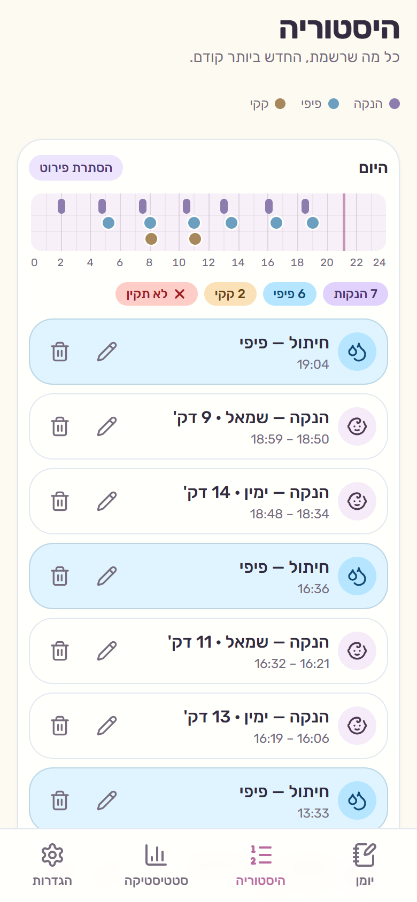
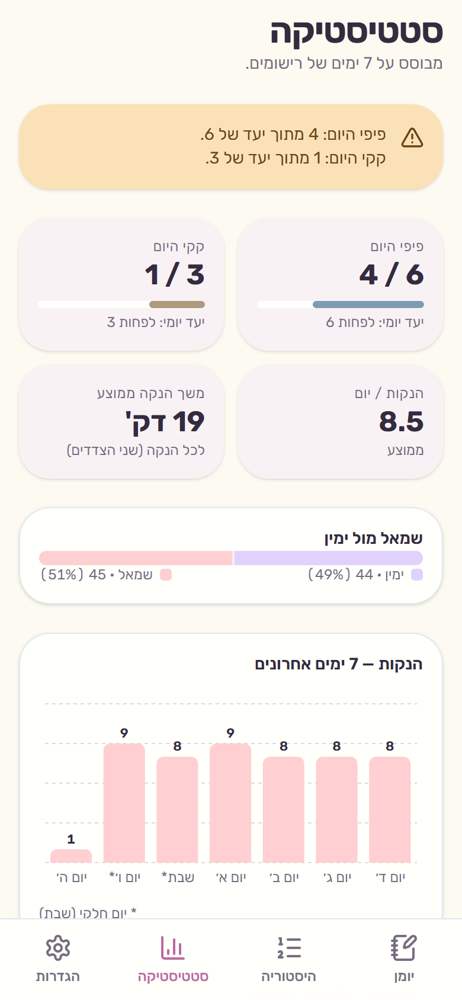
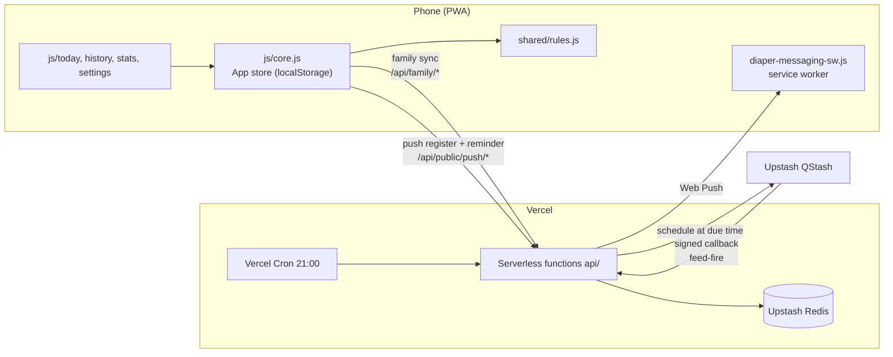

<div dir="rtl">

## יומן תינוק – הנקות, חיתולים וויטמין D

אפליקציית PWA בעברית לרישום הנקות (ימין/שמאל, עם טיימר), חיתולים (פיפי/קקי) מול יעד יומי, ויטמין D וטיפות. כוללת היסטוריה עם ציר זמן יומי, סטטיסטיקה שמתחשבת בשבת, תזכורת להנקה הבאה בהתראת Push גם כשהאפליקציה סגורה, ושיתוף בין בני המשפחה בלי חשבונות. הנתונים נשמרים במכשיר. הפרויקט התחיל כהעתק של mama-helper (Lovable) והורחב משם.

</div>

---

# Baby Feeding Log

A one-tap baby journal for new parents: nursing sessions (left/right with a running timer), wet and dirty
diapers against daily goals, vitamin D and drops, with history, statistics and push reminders.
Mobile-first, Hebrew (RTL), installable, and local-first: everything works offline and stays on the device
unless the family chooses to sync.

**Live:** https://baby-journal-seven.vercel.app

> **Credit.** This project started as a hand-written copy of the Lovable app
> [mama-helper](https://mama-helper-app.lovable.app/) (look and basic flow), and was then rebuilt
> and extended with the features below: Shabbat-aware stats, server push, the feeding reminder, family sync and more.

## Screenshots

| Today | History | Statistics |
|---|---|---|
|  |  |  |

## Features

- **One tap to log.** Start/stop a nursing side (auto-ends after 15 minutes), log a wet or dirty diaper, tick vitamin D.
- **Feedings, not just sides.** Sides nursed one after another count as one feeding.
- **Daily goals.** Wet/dirty diaper goals with progress, and an evening warning (from 20:00) when a goal is not met.
- **Next-feeding reminder.** Progress bar to the next feeding; a server push arrives on time even when the app is closed (Upstash QStash).
- **Evening diaper notification** at 21:00 Israel time via Vercel Cron and Web Push.
- **History.** Per-day timeline (0–24h) with colour-coded events, edit and delete.
- **Statistics.** Feedings per day, average nursing time, left vs right balance, 7-day chart. Days that include
  Shabbat are weighted by their tracked hours (Shabbat times are computed from sunset in Jerusalem).
- **Family sharing without accounts.** One device creates a family and shows a single-use invite code; each device
  gets its own secret (only a hash is stored). Events merge with a last-writer-wins rule plus tombstones.
- **Backup.** Export and import all data as JSON.
- **PWA.** Installable, offline-ready, home-screen icon, service worker for notifications.

## Tech stack

| Layer | Tools |
|---|---|
| Front end | Vanilla JavaScript (ES modules, no build step), compiled Tailwind CSS v4, Rubik font |
| Back end | Vercel Serverless Functions (Node 20) |
| Storage | `localStorage` on the device; Upstash Redis on the server (push devices, family sync) |
| Notifications | Web Push (VAPID, `web-push`), Vercel Cron, Upstash QStash for delayed messages |
| Shared logic | `shared/rules.js`: Shabbat window, day keys, diaper goals, merge rule (used by client and server) |

## Architecture



| Path | What |
|---|---|
| `index.html`, `js/`, `css/`, `extra.css`, `styles.css` | The app (hash routes `#/`, `#/history`, `#/stats`, `#/settings`) |
| `shared/rules.js` | Pure rules shared by client and server |
| `api/public/push/` | Device registration, VAPID public key, feeding reminder + QStash callback |
| `api/family/` | Create / invite / join / sync / leave |
| `api/cron/daily.js` | Evening diaper-goal notification |
| `lib/` | Redis client, rate limiting, QStash, family store, HTTP helpers |
| `CONTRACT.md` | Detailed internal contract between modules |
| `DEPLOY-HE.md` | Step-by-step deployment guide (Hebrew) |

## Run locally

Requires Node 20+.

```bash
npm install
npm run dev          # http://localhost:8110 – static files + the api/ functions, like Vercel
```

The app works fully without any environment variables (data stays in the browser; the server falls back to
in-memory maps). To try push notifications or family sync, copy `.env.example` to `.env.local` and fill in
the values (`npm run vapid` generates a VAPID key pair).

ES modules need `http(s)`, so opening `index.html` from disk does not work.

## Deploy

Deploy the folder to Vercel (no build step), add an Upstash Redis store, and set the variables listed in
[`.env.example`](.env.example) in the Vercel project settings. `vercel.json` defines the cron jobs.
The full walkthrough, including QStash, is in [DEPLOY-HE.md](DEPLOY-HE.md) (Hebrew).

## License

[MIT](LICENSE)
